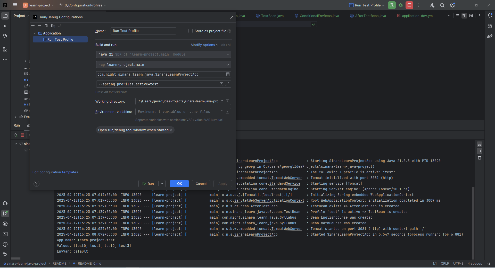
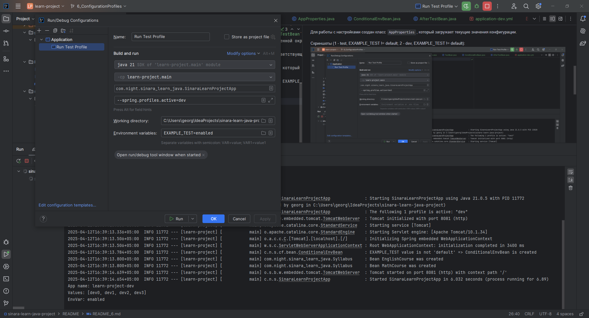

# Task 6. Конфигурация и профили
**ФИО:** Кабицкий Георгий Станиславович

**Преподаватель:** Рогожников Дмитрий  

### Что сделал  

Я создал три профиля — `dev`, `test` и `prod`, каждый из которых содержит:  
- Название приложения: задаётся в конфигурационных файлах для каждого профиля (`learn-project-dev`, `learn-project-test`, `learn-project-prod`)
- Конфиг с листом значений: для каждого профиля задан список строковых значений
- Конфиг с переменной окружения: используется синтаксис `${EXAMPLE_TEST:default}`

### Про бины  
В проекте созданы следующие бины:
- `TestBean`: создаётся, только если активен профиль `test`
- `SecondBean`: создаётся, если ранее был создан бин `TestBean`
- `ConditionalEnvBean`: создаётся, если значение переменной окружения `EXAMPLE_TEST` не равно `default`

При создании каждого из бинов в консоль выводятся соответствующие сообщения, подтверждающие их инициализацию.

Для работы с настройками создан класс `AppProperties`, который загружает текущие значения конфигурации.

Скриншоты (1 - test, EXAMPLE_TEST != default; 2 - dev, EXAMPLE_TEST != default):

 
_`English` и `Math` с задания `Dependencies Injection`_